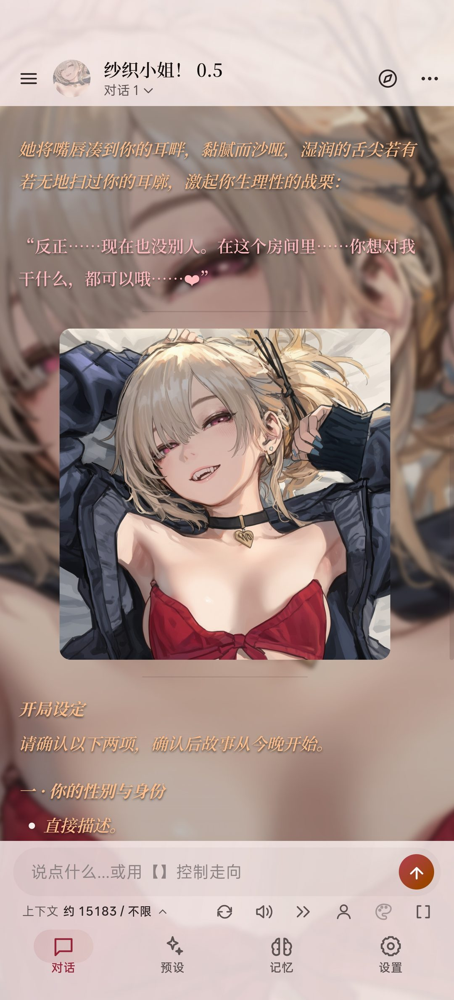
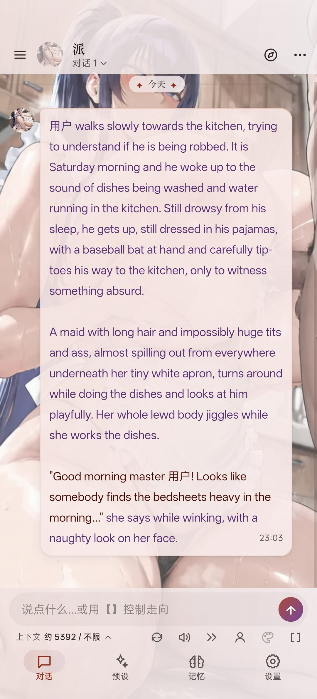
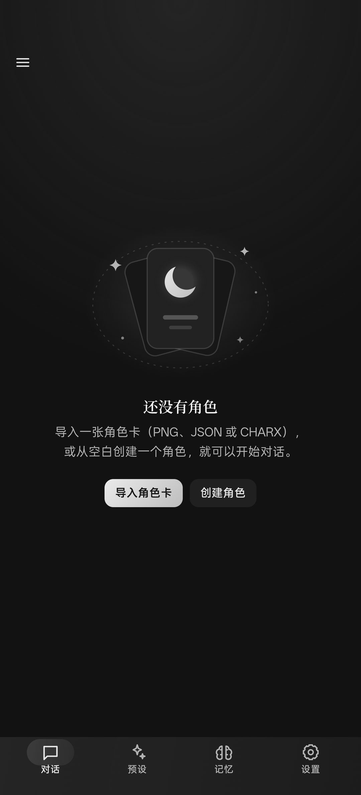

<div align="center">


# 夜欲 Yeyu

**在 Android 手机上直接玩 SillyTavern 与 RisuAI 角色卡，无需电脑、Termux 或服务器。**

[](https://github.com/xujingye666-sketch/yeyu/releases/latest)

[](LICENSE)

### [⬇ 下载最新版 APK](https://github.com/xujingye666-sketch/yeyu/releases/latest)

</div>

- **装上就能玩**：只需安装一个 APK，无需电脑，也不用在手机上折腾 Termux 或酒馆服务。
- **酒馆卡直接导入**：支持 SillyTavern 与 RisuAI 角色卡、预设和世界书，卡内的脚本、正则与前端页面大多也能直接运行。
- **自选模型服务**：支持 OpenAI 兼容接口（如 DeepSeek 及各类中转服务）、Claude、Gemini，也可登录 Grok 订阅使用。
- **数据存在手机里**：角色、聊天记录与设置均保存在手机本地，无需注册账号。

<p align="center">
  <a href="docs/images/character-layout.jpg"></a>
  <a href="docs/images/chat-bubbles.jpg"></a>
  <a href="docs/images/home.jpg"></a>
</p>

以上为实际界面截图，依次是角色卡自定义排版、气泡对话与深色首页（点击可查看大图）。图中的角色、背景和开场白均来自角色卡与用户配置，并非应用内置内容，相关素材的权利归原权利人所有。

## 功能

**角色卡与酒馆生态**

- 导入 PNG、JSON 和 CHARX 角色卡，支持卡内自带的世界书、开场白、正则脚本、前端页面与脚本。
- 支持 SillyTavern 预设、世界书、人格、快捷回复和 STScript，以及酒馆助手脚本、MVU 变量与提示词模板。
- 支持 RisuAI 卡片的 CBS、触发器、Lua、世界书、模块与显示效果。
- 兼容范围与已知差异见[兼容矩阵](docs/COMPATIBILITY_MATRIX.md)。

**模型服务**

- 支持 OpenAI 兼容接口、Anthropic Claude、Google Gemini 和 Grok 订阅。
- 可为对话与辅助任务分别指定模型。

**长对话与玩法**

- 长对话记忆整理、向量检索与附件资料库，帮角色记住更早的剧情。
- 立绘表情、图片生成、语音朗读与消息翻译。
- 支线对话与转盘玩法。
- 界面配色可随角色背景自动调整。

## 安装与上手

1. 前往 [Releases](https://github.com/xujingye666-sketch/yeyu/releases/latest) 下载最新的 `yeyu-<版本号>.apk` 并安装（需 Android 13 或更高版本）。
2. 打开「设置」，填写模型服务的 API 地址、Key 和模型名称。
3. 在侧栏「角色」中导入角色卡，或直接新建角色。
4. 选择角色即可开始对话；预设、世界书和人格可在各自页面中管理。

应用启动或切回前台时会自动检查有无新的正式版（每天最多一次），也可在侧栏版本号旁的「关于」中手动检查。发现新版本后，点击「前往更新」会在浏览器中打开发布页面，下载后直接覆盖安装即可，聊天数据会保留。

## 常见问题

**需要自己准备模型吗？**

需要。夜欲本身不提供模型服务，请自备 API Key，或在设置中登录 Grok 订阅。默认服务商已预填 DeepSeek 官方地址，填入 Key 就能直接对话。

**卡片效果和电脑上的酒馆不一样怎么办？**

请先查看[兼容矩阵](docs/COMPATIBILITY_MATRIX.md)中的已知差异；如果不在其中，欢迎[提交 Issue](https://github.com/xujingye666-sketch/yeyu/issues)，并附上卡片来源与复现步骤。

**卸载或换装其他签名的版本会怎样？**

数据保存在应用内部存储中，卸载会清空全部数据。自行构建的版本与官方发布版签名不同，无法直接覆盖安装，切换前需要先卸载原应用。

## 自行构建与开发

<details>
<summary>构建 APK</summary>

构建需要 JDK 17 或更高版本（可直接使用 Android Studio 自带的 JDK）和 Android SDK 35。

```powershell
.\gradlew.bat :app:assembleDebug
```

生成的 APK 位于 `app/build/outputs/apk/debug/app-debug.apk`。如需构建自签名的 Release 版本，请参照[发布检查清单](docs/RELEASE_CHECKLIST.md#构建环境与-debug)配置签名。自签名版本与官方发布版无法直接互相覆盖安装，详见[常见问题](#常见问题)。

</details>

<details>
<summary>开发与测试</summary>

测试与门禁脚本需在 Windows 下运行，依赖 PowerShell 7、Git、Python、Node.js 和 Microsoft Edge。首次运行前先在项目根目录执行 `npm ci`，然后运行：

```powershell
pwsh -NoProfile -ExecutionPolicy Bypass -File tools/qa/run_project_checks.ps1 -Gate Fast
```

刚克隆仓库且尚未拉取正式 tag 时，可加上 `-BaselineRef HEAD`。验证方式、测试准入和版本规则见[发布检查清单](docs/RELEASE_CHECKLIST.md)，代码结构见[架构说明](docs/ARCHITECTURE.md)与[前端模块索引](docs/FRONTEND_MODULES.md)，数据格式见[数据模型](docs/DATA_MODEL.md)，界面规范见 [DESIGN.md](DESIGN.md)。

</details>

## 许可

本项目采用 [GNU Affero General Public License v3.0](LICENSE) 许可证发布。随应用分发的第三方库、字体和素材仍遵循各自原有的许可，具体来源与许可证文件见[本地发行依赖](docs/FRONTEND_MODULES.md#本地发行依赖)。应用图标由 OpenAI 图像生成工具制作，源图与适配图随项目按 AGPL-3.0 分发。

## 反馈

问题与建议欢迎提交 [Issues](https://github.com/xujingye666-sketch/yeyu/issues)，或发邮件至 xujingye666@gmail.com。

如果夜欲对你有帮助，欢迎点一颗 Star ⭐
